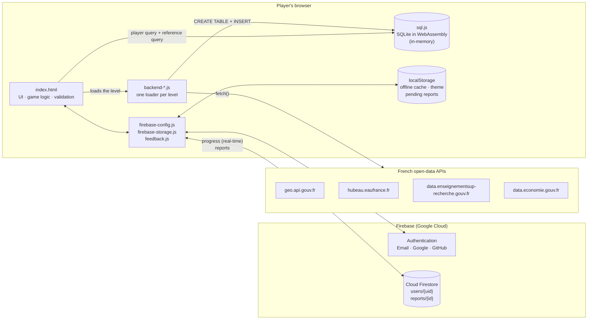
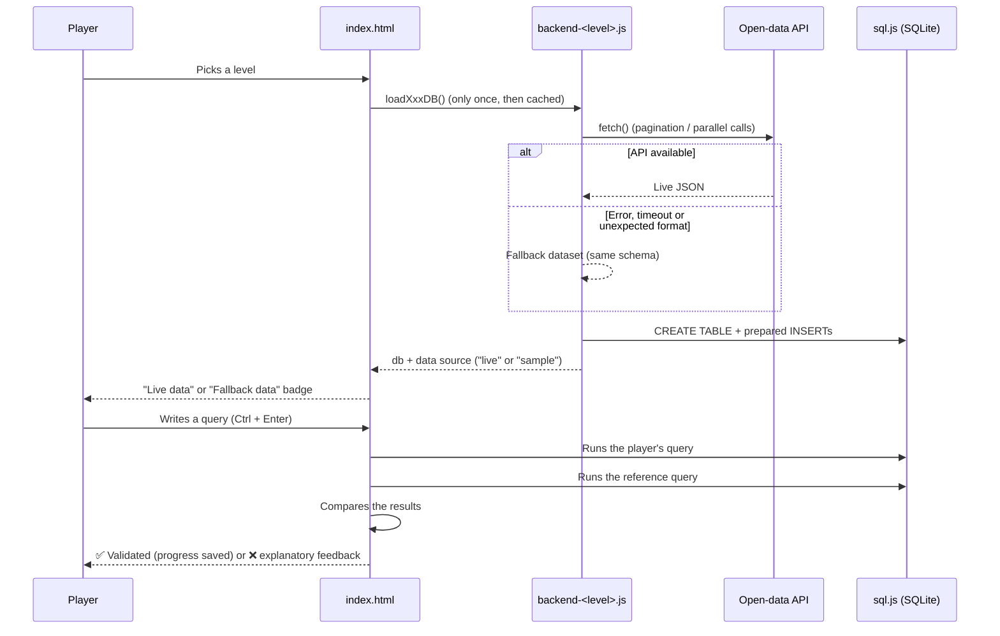

# QueryReal

**Learn SQL by querying real French public data, directly in your browser.**

QueryReal is an educational web game: players write real SQL queries against SQLite databases built on the fly from official open-data APIs (communes, river water quality, universities, the State budget). Each query is executed in the browser and compared with an expected result, giving instant feedback. The game needs no installation and no server-side code.

> The interface is in French. The code, comments and documentation are in English and French.

---

## Table of contents

1. [Purpose](#purpose)
2. [Features](#features)
3. [Levels and datasets](#levels-and-datasets)
4. [Data sources (APIs)](#data-sources-apis)
5. [Architecture](#architecture)
6. [Project structure](#project-structure)
7. [Technical details](#technical-details)
8. [Firebase: authentication, progress and feedback](#firebase-authentication-progress-and-feedback)
9. [Getting started](#getting-started)
10. [Design principles](#design-principles)
11. [Roadmap](#roadmap)

---

## Purpose

Most SQL tutorials rely on small synthetic tables that look nothing like the data you meet at work. QueryReal takes the opposite approach:

- **Real data.** Every level is backed by an official French open-data API, with its real volumes, its real quirks and its real gaps.
- **Progressive difficulty.** From `SELECT *` to stacked CTEs and window functions, in five levels of ten challenges each.
- **Zero friction.** Nothing to install and no database server to set up. An account is optional.

The project has two goals:

1. **A learning tool** for students and career-changers moving into data roles (Data Analyst, Analytics Engineer, Data Engineer).
2. **A portfolio project** demonstrating SQL, front-end development, open-data sourcing and integration of a cloud backend (Firebase).

---

## Features

| Feature | Description |
|---|---|
| **10 challenges per level** | Unlocked in order. A level must be fully completed to unlock the next one. |
| **Instant validation** | The player's result set is compared with the result of a reference query (values, row count, and order when required). |
| **Explanatory feedback** | Wrong number of rows or columns, values correct but in the wrong order, SQL error messages, optional hints. |
| **Schema panel** | Data source, description, tables and columns for the current level. |
| **SQL help panel** | The concepts introduced in the level, each with a short example. |
| **Accounts** | Email/password, Google or GitHub sign-in. Progress is synced in real time across devices. |
| **Guest mode** | Play without an account. Progress stays in memory and is lost when the tab is closed (the player is warned). It is attached to the account if the player signs up afterwards. |
| **Proposals / problems** | An always-visible button opens a 5-step survey (topic → details → screenshot → submit) to collect suggestions and bug reports. |
| **Light / dark theme** | Follows the system setting by default and is remembered on the device. |
| **Responsive design** | 3-column layout on desktop; slide-in panels on tablets and phones; touch-friendly controls. |
| **Accessibility** | Keyboard navigation, `aria-live` regions, visible focus states, and `prefers-reduced-motion` respected. |

---

## Levels and datasets

| Level | Dataset | Tables | SQL concepts |
|---|---|---|---|
| 🟢 **Beginner** | French communes (~35,000 rows) | `city` | `SELECT`, `WHERE`, `ORDER BY`, `LIMIT`, `IN`, `GROUP BY`, `COUNT`, `AVG`, `MIN`/`MAX` |
| 🔵 **Intermediate** | River water quality (Naïades) | `station`, `measurement` | `JOIN`, `LEFT JOIN`, aggregation on joins, `CREATE TABLE … AS SELECT` |
| 🟡 **Advanced** | Public universities and 2024 enrollment | `university`, `enrollment` | Subqueries, CTEs (`WITH`), `ROW_NUMBER`, `RANK`, `PARTITION BY` |
| 🟠 **Expert** | State budget, "Santé" mission (2015–2025) | `balance`, `posting_ref` | `LAG`, year-over-year variation (absolute and %), stacked CTEs, `HAVING`, volatility |
| 🟣 **Méga Expert** | *In preparation* | — | Anomaly detection, hand-computed standard deviation (SQLite has no `STDDEV`) |

### Schemas

```text
-- Beginner
city(insee_code, name, department_code, population)

-- Intermediate
station(station_code, station_name, city_name, river)
measurement(station_code, parameter, sample_date, result, unit)

-- Advanced
university(uai, name, type, department_code, city)
enrollment(uai, student_count)

-- Expert
balance(year, mission, posting_category, sub_posting_category, program,
        account_code, account_name, nature_budgetaire, balance)
posting_ref(posting_category, description)
```

---

## Data sources (APIs)

All APIs are public, **require no API key**, support CORS, and are called **directly from the player's browser**.

### Beginner — Administrative boundaries API (`geo.api.gouv.fr`)

- **Publisher:** Etalab / DINUM
- **Endpoint:** `GET https://geo.api.gouv.fr/communes?fields=nom,code,codeDepartement,population&format=json&geometry=none`
- **Volume:** every commune with a known population (~35,000 rows) in a single call. No filter is applied on purpose.
- **Mapping:** `code → insee_code`, `nom → name`, `codeDepartement → department_code`.

### Intermediate — Hub'Eau, river water quality (`hubeau.eaufrance.fr`)

- **Publisher:** BRGM / OFB / Ministry for Ecological Transition (Naïades dataset)
- **Endpoints:**
  - `station_pc` → `station` table (reference table)
  - `analyse_pc` → `measurement` table (fact table)
- **Volume constraints and how they are handled:**
  - The full dataset contains tens of millions of analyses across ~236 parameters. Only the **4 parameters used in the challenges** are loaded: nitrates, total phosphorus, ammonium and water temperature. Analyses start from 2016-01-01.
  - Hub'Eau caps query *depth* at 20,000 rows. The request is therefore **split into one query per parameter**, run in parallel (up to 4 × 20,000 rows).
  - Failures are **isolated per parameter**: one failing call does not trigger the global fallback.
- **Teaching value:** stations and measurements come from two independent calls, so some stations have no measurements. This makes `LEFT JOIN` genuinely necessary.

### Advanced — Ministry of Higher Education and Research (`data.enseignementsup-recherche.gouv.fr`)

- **Dataset:** `fr-esr-principaux-etablissements-enseignement-superieur` (OpenDataSoft Explore API v2.1)
- **Filter:** `secteur_d_etablissement="public" AND typologie_d_universites_et_assimiles IS NOT NULL`
- **Pagination:** pages of 100 records (`limit` / `offset`), deduplicated by UAI code.
- **Scope:** public universities. Only those with official 2024 enrollment figures (`inscrits_2024`) appear in `enrollment`, which is a 1-to-1 relationship on `uai`.
- **Quota:** 5,000 anonymous calls per day per IP.

### Expert — Ministry of Economy and Finance (`data.economie.gouv.fr`)

- **Dataset:** `balances_des_comptes_etat` (OpenDataSoft Explore API v2.1)
- **Filter:** `libellemission='Santé' AND year(annee) BETWEEN 2015 AND 2025`
- **Pagination:** pages of 100 records, up to 10,000 rows, with a 30-second timeout per page and a 200 ms pause between pages to stay polite with the API.
- **Derived table:** `posting_ref` is built on the client by deduplicating the posting categories.

---

## Architecture

QueryReal is a **static application** (HTML, CSS and vanilla JavaScript, with no framework and no build step). It relies on three kinds of external services: the **open-data APIs** (the data), **sql.js** (the SQL engine) and **Firebase** (accounts, progress and feedback).



### Lifecycle of a level



---

## Project structure

```text
query-real/
├── index.html               # UI (HTML + CSS), level and challenge definitions, game engine
├── backend-beginner.js      # Loader for the Beginner level (communes)
├── backend-intermediate.js  # Loader for the Intermediate level (Hub'Eau)
├── backend-advanced.js      # Loader for the Advanced level (universities)
├── backend-expert.js        # Loader for the Expert level (State budget)
├── firebase-config.js       # Firebase initialisation, authentication, guest mode
├── firebase-storage.js      # Progress persistence (Firestore + local cache + merging)
├── feedback.js              # "Proposal / problem" survey (5 steps, screenshots)
├── firestore.rules          # Firestore security rules
└── README.md
```

### Responsibilities of each file

| File | Role | Main exports / entry points |
|---|---|---|
| `index.html` | Interface (loading, sign-in, home, levels and game pages), styles and responsive design, light/dark theme, `levels` object (datasets, concepts, challenges, reference queries), validation engine, navigation, panels, modals. | `showPage`, `showGame`, `runQuery`, `resultsMatch`, `updateLevelsPageUI` |
| `backend-*.js` | Each file is an IIFE that calls its API, maps the fields, builds the SQLite database and falls back to a sample dataset on failure. All four follow the same pattern. | `window.loadBeginnerDB`, `loadIntermediateDB`, `loadAdvancedDB`, `loadExpertDB` |
| `firebase-config.js` | Firebase initialisation, listener for auth state changes, sign-in by email, Google or GitHub (popup, with redirect as a fallback on mobile), guest mode. | `auth`, `db`, `currentUser`, `isGuest`, `startGuestMode`, `logIn`, `signUp`, `logOut` |
| `firebase-storage.js` | Progress store: Firestore as the source of truth, synchronous in-memory cache, `localStorage` cache per account, merging across devices, real-time listener. | `initProgressForUser`, `getProgressSync`, `setProgress` |
| `feedback.js` | Proposal and problem survey: question tree, automatic context, screenshot capture and compression, sending to Firestore, offline queue. | `openReport(category?)` |
| `firestore.rules` | Access control: each user only accesses their own document; reports can be created but not read from the client, with their contents validated. | — |

### Script loading order

The order matters, because each script relies on globals defined by the previous ones.

```text
<head>  firebase-app / auth / firestore (compat 9.23)  ·  html2canvas (defer)
<body>  sql-wasm.js → backend-*.js → firebase-config.js → firebase-storage.js → feedback.js → main script
```

---

## Technical details

### In-browser SQL engine

- **sql.js 1.10.3** (SQLite compiled to WebAssembly), loaded from cdnjs. The `.wasm` file is resolved through `locateFile`.
- **One in-memory database per level**, created on first entry and then cached (`dbCache`). Concurrent calls share the same promise (`dbPromiseCache`), and a failed load can be retried.
- Inserts use **prepared statements** (`db.prepare` / `stmt.run`).
- The display is capped at **200 rows** (`RESULT_DISPLAY_CAP`), while **validation always compares the full result set**.

### Validation engine

Each challenge declares a **reference query**. The player's result is accepted when:

- the **number of columns and rows** matches;
- the **values** match after normalisation: numbers rounded to 4 decimals, strings trimmed, `NULL` kept;
- if `orderMatters: true`, the **order** matches; otherwise both result sets are sorted before comparison.

Column names are not compared, so aliases are free.

Special cases:

| Challenge property | Behaviour |
|---|---|
| `type: 'create'` | `CREATE TABLE … AS SELECT` challenge: the target table is dropped, the player's query is run, and its contents are compared with a reference table `__ref_<name>`. |
| `setup` | Recreates tables that a challenge depends on (for example `river_quality_summary`) if the player has not created them. |
| `requiredKeyword` | Requires a keyword (for example `LEFT JOIN`) when the expected result could also be reached without it. |

Typographic quotes (`'` `"`) are normalised before execution, which avoids common errors when pasting from a word processor or typing on a phone.

### Fallback strategy

Every loader follows the same pattern: **try the live API first, then fall back to a sample dataset with the same schema**. The data source is stored on the database object (`db.__queryRealDataSource`) and shown to the player: "live official data" or "fallback data (API unavailable)". The two are never swapped silently.

Fallback datasets are deliberately small. They let the player keep practising, but they do not pretend to be the real data.

### Interface

- **Layout:** 3 columns (Schema | Challenge | SQL help) from 1000 px; slide-in panels below that; phone-specific adjustments up to 640 px. The layout also handles notches (`safe-area-inset`) and uses 16 px input fields to prevent automatic zoom on iOS.
- **Theme:** CSS variables on `:root`, with a `[data-theme="light"]` override. The theme is applied before the first render to avoid a colour flash.
- **Interactions:** the result box animates on success or error, confetti appears when a level is completed, and keyboard shortcuts are available (Ctrl/⌘ + Enter to run, Tab to indent, Esc to close).

---

## Firebase: authentication, progress and feedback

**Firebase services used:** Authentication and Cloud Firestore (JavaScript SDK *compat* 9.23.0). No Firebase Storage or Cloud Functions are used.

### Authentication

- Providers: **email/password**, **Google**, **GitHub**.
- `signInWithPopup` is used by default, with automatic fallback to `signInWithRedirect` when the popup is blocked (common on mobile).
- The interface is only shown once the account's progress has loaded, so the levels are never computed from an empty cache.

### Firestore data model

```text
users/{uid}
├── email          : string
├── createdAt      : timestamp
├── lastUpdated    : timestamp
└── progress
    └── <levelId>                  # beginner | intermediate | advanced | expert
        ├── challengeIndex : number      # furthest unlocked challenge
        ├── completed      : boolean[]   # one entry per challenge
        └── answers        : string[]    # last validated query

reports/{autoId}
├── category, categoryLabel        # suggestion | query | interface | data | account | perf | other
├── topics[]                       # selected detail options
├── scope                          # challenge | level | platform
├── severity, frequency
├── title, description
├── stepsToReproduce, expected, observed, benefit
├── contactEmail, uid              # optional
├── context                        # page, level, challenge, query, last result, data source, device…
├── screenshots[]                  # JPEG data URLs (≤ 3, compressed to stay under 1 MB)
├── status                         # "new"
└── createdAt                      # server timestamp
```

### Progress synchronisation

1. **At sign-in**, four sources are merged: the account's local cache, any progress made in guest mode, any legacy local progress (pre-v5) and the Firestore document. The merged state is then written back to Firestore with `set(..., { merge: true })`.
2. **Merge rule:** a challenge validated on any device stays validated, and the furthest `challengeIndex` wins.
3. **While playing**, reads come from an in-memory cache (synchronous), and writes update only the current level (nested map with `merge: true`).
4. **In real time**, an `onSnapshot` listener applies changes made on another device without reloading the page.
5. **Offline**, `localStorage` (one key per account) acts as a cache when Firestore is unreachable.

### Guest mode

- Progress lives **in memory only**. A banner tells the player that nothing is saved, and the browser asks for confirmation before the tab is closed if the player has made progress.
- If the guest signs in afterwards, their progress is **attached to the account**. When sign-in goes through a redirect (which reloads the page), the progress is handed over temporarily through `sessionStorage`.

### Proposals and problems survey (`feedback.js`)

A floating button, available on every page, opens a **5-step survey that goes from the broadest to the most specific**:

1. **Topic:** improvement suggestion, challenge issue, interface, data, account and saving, performance, other.
2. **Details:** checkboxes specific to each topic (for example "my correct query is rejected", "unclear wording"), plus the scope.
3. **Specifics:**
   - for bugs: severity, frequency, steps to reproduce, and expected versus observed result;
   - for suggestions: the expected benefit;
   - in both cases: title, description, and an optional contact email.
4. **Screenshot:** capture of the current page (html2canvas) or image import, up to 3, resized and compressed to JPEG.
5. **Summary and submit.**

The **technical context** is attached automatically, with the player's consent: level, challenge, current query, last result, data source, screen size, theme and browser.

If submission fails, the report is **queued in `localStorage`** and resent on the next visit, and the player can also download it as JSON. A "Report this challenge" shortcut appears under rejected queries and opens the survey with the topic already selected.

### Security

- The Firebase `apiKey` in `firebase-config.js` is **public by design**. It identifies the project but grants no rights on its own. **Access is controlled by `firestore.rules`**:
  - `users/{uid}`: read and write allowed only for the authenticated owner.
  - `reports/{id}`: creation allowed for everyone (including guests), with validation of the category, field lengths, number of screenshots, server timestamp and `uid` consistency. Reading, updating and deleting are forbidden from the client; reports are reviewed in the Firebase console.
- Recommended: restrict **authorised domains** in Firebase Authentication to the domains where the site is hosted.
- All content injected into the DOM from user input or API data is escaped (`escapeHtml`).

---

## Getting started

### Play locally

The application is static, but Firebase Authentication requires an `http(s)` origin. Serve the folder with any static server:

```bash
git clone https://github.com/o2FintechDev/query-real.git
cd query-real
python3 -m http.server 8000
# then open http://localhost:8000
```

`localhost` is authorised by default in Firebase. Guest mode works even without Firebase.

### Deploy

Any static host works (GitHub Pages, Firebase Hosting, Netlify…). After deploying:

1. Add the domain to **Firebase Console → Authentication → Settings → Authorised domains**.
2. Publish `firestore.rules` in **Firestore Database → Rules**.
3. Enable the **Email/Password**, **Google** and **GitHub** providers in Authentication. GitHub requires creating an OAuth App.

### Use your own Firebase project

Replace the `firebaseConfig` object in `firebase-config.js` with your project's configuration, then repeat the three steps above.

### Add a level

1. Create `backend-<level>.js` following the existing pattern (API call → mapping → fallback → `CREATE TABLE` / `INSERT` → `db.__queryRealDataSource`), and expose `window.load<Level>DB`.
2. Include the script in `index.html` before `firebase-config.js`.
3. Add an entry to the `levels` object (`backendLoader`, `database`, `concepts`, `challenges` with their `reference` queries), and to `levelsOrder` and the levels page.

---

## Design principles

- **Real data first.** The educational value comes from real datasets, with their volumes and imperfections.
- **Transparency.** The player always knows whether they are querying live data or a fallback.
- **Progressive learning.** Each challenge introduces a single new concept and reuses the previous ones.
- **Zero friction.** Static site, optional account, works on desktop and on phones.
- **Listening to users.** Feedback is collected in a structured, detailed and contextualised way to guide improvements.

---

## Roadmap

- [ ] **Méga Expert** level: anomaly detection (deviation from the mean, hand-computed standard deviation), multi-CTE queries.
- [ ] SQL syntax highlighting in the editor.
- [ ] Statistics page (validated challenges, attempts, time spent).
- [ ] Back-office for reviewing and triaging feedback (`reports`).
- [ ] Automated tests for reference queries against fallback datasets.

---

*Data: Etalab / DINUM, Hub'Eau (BRGM, OFB), Ministry of Higher Education and Research, Ministry of Economy and Finance — open licences. QueryReal is an independent project and is not affiliated with these organisations.*